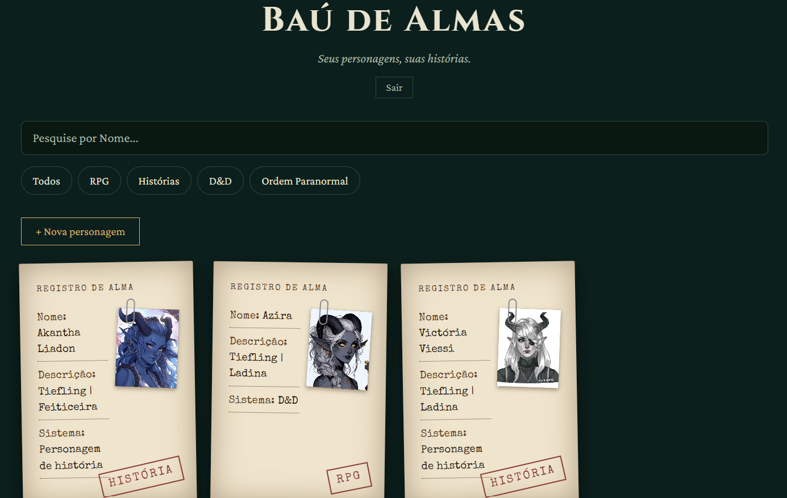
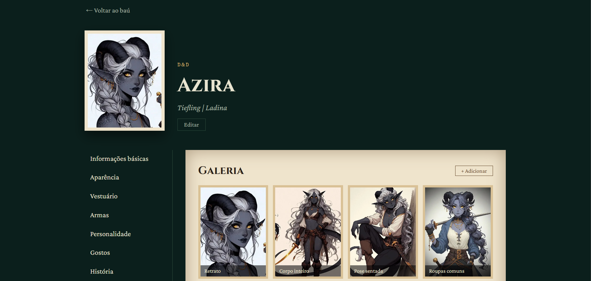
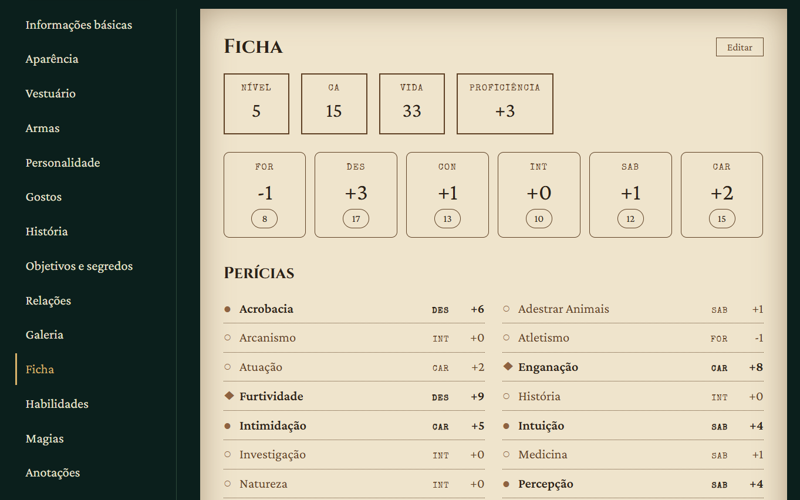
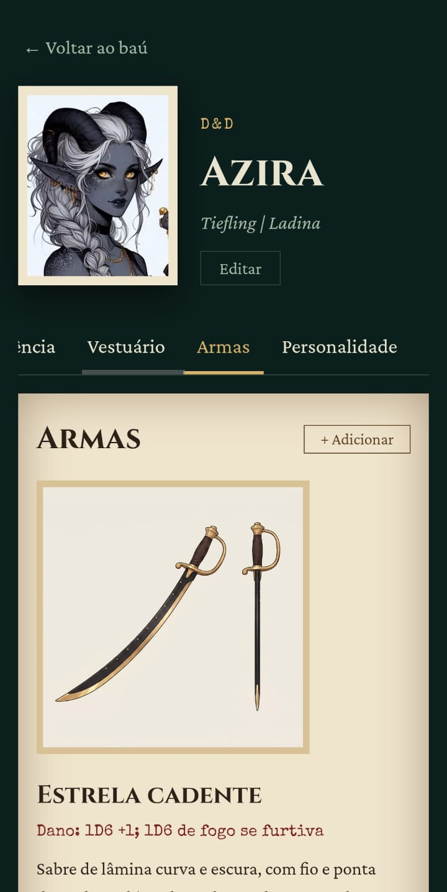

# 🗝️ Baú de Almas

> Your characters, your stories.

[🇧🇷 Português](README.md) · 🇺🇸 English

*Baú de Almas* means "Chest of Souls". It is a personal website to store and organize the characters I create, both for stories and for tabletop RPGs (D&D and Ordem Paranormal), with character sheets, images and chapters about each one's life.

<p align="center">
  
</p>

🔗 **Live site:** [bau-de-almas.vercel.app](https://bau-de-almas.vercel.app)
👀 You can enter as a **visitor** and explore the characters without logging in (read-only).

> The interface is in Brazilian Portuguese.

## ✨ Features

- **Animated entrance:** a walk through a layered forest (parallax effect) to a chest that unlocks and opens before the login
- **Catalog** styled as "soul records", with name search and filters by type and system
- **Character page** split into chapters: basic info, appearance, outfits, weapons, personality, likes, story, goals and secrets, relationships, gallery, sheet, abilities, spells or rituals, and notes
- **Everything is editable on the site itself**, chapter by chapter, and each outfit, weapon, relationship or image individually
- **Formatted text** with bold, italics, lists and quotes (Markdown)
- **Image upload** for portraits, outfits, weapons, relationships and the gallery
- **Automatic gallery:** gathers the images from every chapter, with a full-size view
- **RPG sheets:**
  - **D&D:** modifiers, proficiency bonus and skills calculated automatically, with proficiency and expertise
  - **Ordem Paranormal:** class, path, origin and skills by training level
- **Confirmation dialog** styled like the site before any deletion
- **Mobile version**

## 📸 Screens

| Catalog | Character |
|---|---|
|  |  |

| RPG sheet | Mobile |
|---|---|
|  |  |

## 🛠️ Tech stack

- **React 19** with **Vite**
- **React Router**: navigation between pages and chapters
- **Supabase**:
  - **Auth** for the login
  - **Postgres** for the data, with access rules (Row Level Security)
  - **Storage** for the images
- **react-markdown**: formatted text
- **Plain CSS**: `@keyframes` animations, Grid, Flexbox and media queries
- **Vercel**: automatic deploy on every `git push`
- **Git and GitHub**, following Conventional Commits

## 💡 What I learned

- Building the interface with React components and reusing them
- Managing state with `useState` and effects with `useEffect`
- Routes with parameters (`/personagem/:id/:capitulo`)
- Authentication and database security: each user can only read and change her own data
- File upload with access rules per folder
- Storing flexible data in a `jsonb` column, one object per chapter
- Working with `async`/`await` and Promises, including a custom confirmation dialog
- CSS-only animations that wait for the images to load before starting
- Responsive layout for mobile
- Deploying a site with environment variables and route configuration
- Accessibility: alt texts, keyboard focus and respecting the "reduce motion" setting

## ▶️ Running locally

1. Install the dependencies:
   ```bash
   npm install
   ```
2. Create a [Supabase](https://supabase.com) project with:
   - a `personagens` table with the columns `id`, `nome`, `resumo`, `sistema`, `foto` and `capitulos` (`jsonb`);
   - a public bucket called `imagens`.
3. Create a `.env.local` file in the project root:
   ```
   VITE_SUPABASE_URL=your-supabase-url
   VITE_SUPABASE_PUBLISHABLE_KEY=your-publishable-key
   ```
4. Run:
   ```bash
   npm run dev
   ```
5. Open `http://localhost:5173` in the browser.

## 🎨 Process and artwork

The idea, the visual identity and the art direction are mine. I designed the look before writing the code (the mockup is in `docs/mockup-entrada.png`). The forest and chest illustrations were generated with AI (Gemini) from my art direction and then edited and processed to work as layers: background removal, upscaling, and color and fog adjustments.

## 🧭 Next steps

- [ ] Sheets for other systems: Tormenta, Call of Cthulhu and Vampire: The Masquerade
- [ ] Different visual themes for each character

## 👩‍💻 Author

Made by **Stefany Campos**, Software Engineering student.

[LinkedIn](https://www.linkedin.com/in/stefany--campos/) · [GitHub](https://github.com/stefanycamposofc-oss)