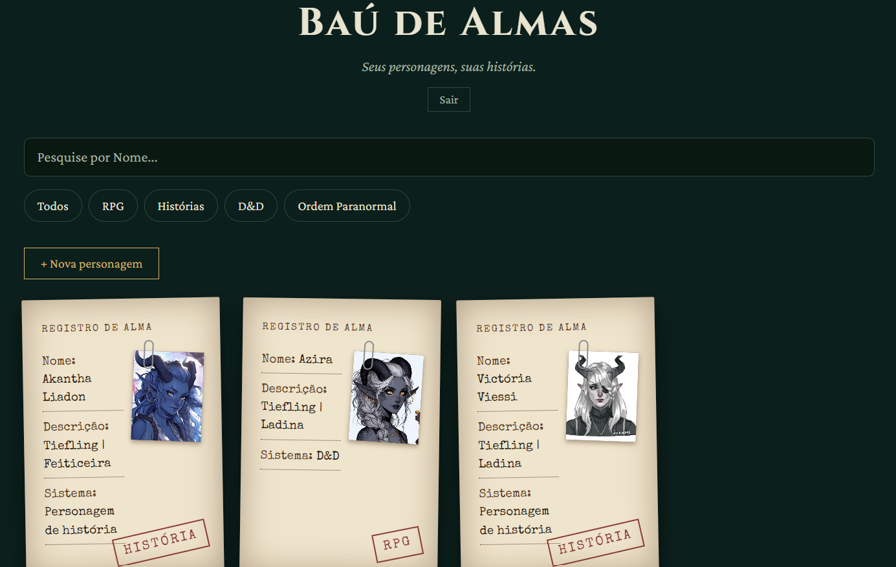
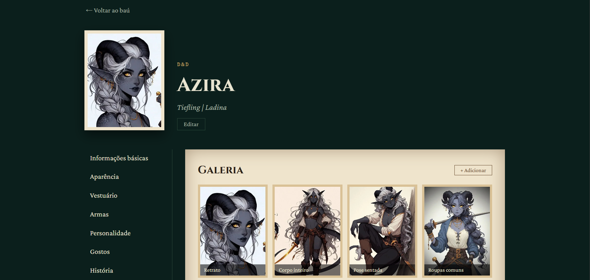
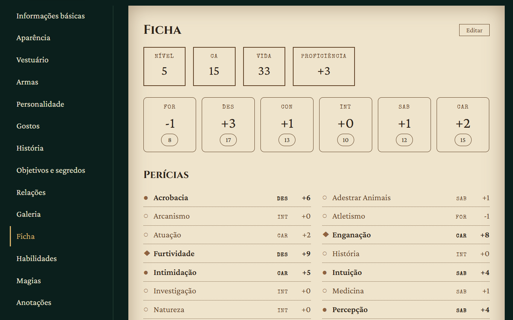
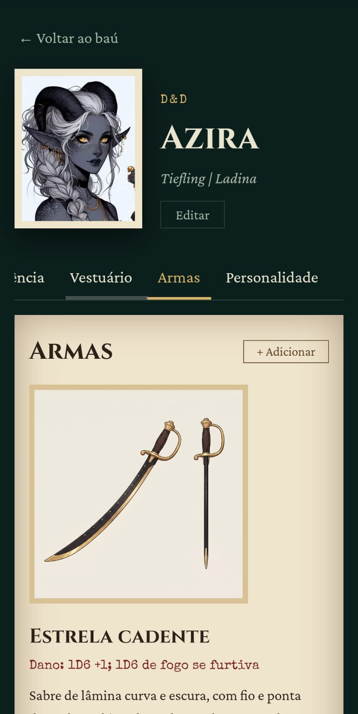

# 🗝️ Baú de Almas

> Seus personagens, suas histórias.

🇧🇷 Português · [🇺🇸 English](README.en.md)

Site pessoal para guardar e organizar os personagens que eu crio, tanto de histórias quanto de RPG (D&D e Ordem Paranormal), com fichas, imagens e capítulos sobre a vida de cada um.

<p align="center">
  
</p>

🔗 **Site no ar:** [bau-de-almas.vercel.app](https://bau-de-almas.vercel.app)
🔒 O acesso é protegido por login, porque o baú é pessoal.

## ✨ Funcionalidades

- **Entrada animada:** caminhada por uma floresta em camadas (efeito parallax) até um baú que destranca e abre antes do login
- **Catálogo** em estilo "registro de alma", com busca por nome e filtros por tipo e sistema
- **Página da personagem** dividida em capítulos: informações básicas, aparência, vestuário, armas, personalidade, gostos, história, objetivos e segredos, relações, galeria, ficha, habilidades, magias ou rituais e anotações
- **Edição de tudo pelo próprio site**, capítulo por capítulo, e de cada roupa, arma, relação ou imagem separadamente
- **Texto formatado** com negrito, itálico, listas e citações (Markdown)
- **Upload de imagens** para fotos, roupas, armas, relações e galeria
- **Galeria automática:** reúne as imagens de todos os capítulos, com visualização ampliada
- **Fichas de RPG:**
  - **D&D:** modificadores, bônus de proficiência e perícias calculados automaticamente, com proficiência e especialização
  - **Ordem Paranormal:** classe, trilha, origem e perícias por grau de treinamento
- **Confirmação** com o visual do site antes de qualquer exclusão
- **Versão para celular**

## 📸 Telas

| Catálogo | Personagem |
|---|---|
|  |  |

| Ficha de RPG | Celular |
|---|---|
|  |  |

## 🛠️ Tecnologias

- **React 19** com **Vite**
- **React Router**: navegação entre páginas e capítulos
- **Supabase**:
  - **Auth** para o login
  - **Postgres** para os dados, com regras de acesso (Row Level Security)
  - **Storage** para as imagens
- **react-markdown**: texto formatado
- **CSS puro**: animações com `@keyframes`, Grid, Flexbox e media queries
- **Vercel**: publicação automática a cada `git push`
- **Git e GitHub**, com commits no padrão Conventional Commits

## 💡 O que eu aprendi

- Componentizar a interface em React e reaproveitar componentes
- Controlar estado com `useState` e efeitos com `useEffect`
- Rotas com parâmetros (`/personagem/:id/:capitulo`)
- Autenticação e segurança no banco: cada usuária só lê e altera os próprios dados
- Upload de arquivos com regras de acesso por pasta
- Guardar dados flexíveis numa coluna `jsonb`, um objeto por capítulo
- Trabalhar com `async`/`await` e Promises, inclusive para criar um pop-up de confirmação próprio
- Animações só com CSS, esperando as imagens carregarem antes de começar
- Layout responsivo para celular
- Publicar um site com variáveis de ambiente e configuração de rotas
- Acessibilidade: textos alternativos, foco no teclado e respeito à preferência de "reduzir movimento"

## ▶️ Como rodar o projeto

1. Instale as dependências:
   ```bash
   npm install
   ```
2. Crie um projeto no [Supabase](https://supabase.com) com:
   - uma tabela `personagens` com as colunas `id`, `nome`, `resumo`, `sistema`, `foto` e `capitulos` (`jsonb`);
   - um bucket público chamado `imagens`.
3. Crie o arquivo `.env.local` na raiz do projeto:
   ```
   VITE_SUPABASE_URL=sua-url-do-supabase
   VITE_SUPABASE_PUBLISHABLE_KEY=sua-chave-publica
   ```
4. Rode:
   ```bash
   npm run dev
   ```
5. Abra `http://localhost:5173` no navegador.

## 🎨 Processo e artes

A ideia do site, a identidade visual e a direção de arte são minhas. Planejei o visual antes do código (o mockup está em `docs/mockup-entrada.png`). As ilustrações da floresta e do baú foram geradas com IA (Gemini) a partir da minha direção de arte e depois editadas e tratadas para funcionar em camadas: recorte do fundo, aumento de resolução e ajuste de cor e névoa.

## 🧭 Próximos passos

- [ ] Fichas de outros sistemas: Tormenta, Call of Cthulhu e Vampiro: A Máscara
- [ ] Temas visuais diferentes para cada personagem

## 👩‍💻 Autora

Feito por **Stefany Campos**, estudante de Engenharia de Software.

[LinkedIn](https://www.linkedin.com/in/stefany--campos/) · [GitHub](https://github.com/stefanycamposofc-oss)